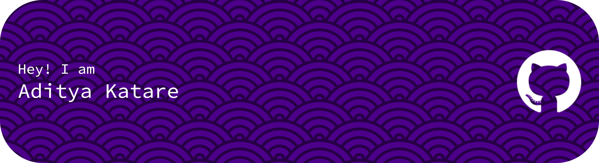

# Aditya Katare

Software Engineer at **SuretyNow** · Bangalore, India

I build practical software end to end, from data pipelines and backends to the interfaces people actually use. Before SuretyNow I was a project intern at ISRO, building backend processing for raw satellite data and GUIs for visualising satellite orbits. I studied Computer Science (B.Tech) at Ramaiah University of Applied Sciences.

[LinkedIn](https://www.linkedin.com/in/adityamkatare)

## Selected projects

- **[BLR Flat Hunt](https://github.com/AdityaKatare/blr-rentals)**: one search across Bangalore's rental portals ([live](https://blrflathunt.vercel.app))
- **[Laundry POS](https://github.com/AdityaKatare/laundry-pos)**: offline point-of-sale app for the SUNMI D3 Mini
- **[Fire TV Remote](https://github.com/AdityaKatare/firetv-remote)**: Windows remote for Fire TV over ADB
- **[Chat with PDF](https://github.com/AdityaKatare/chat-with-pdf)**: ask questions of your PDFs with an LLM

## Tools I work with

Python · TypeScript / JavaScript · Java · SQL · React · Node.js · LangChain · TensorFlow / Keras · Git
